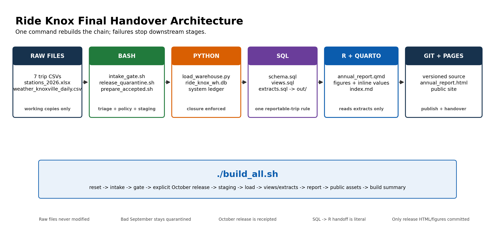

# Ride Knox Final Handover

This repository is the handover for Ride Knox's 2025-2026 analytical system. A successor can place the raw course files in `data/`, run one command, and rebuild the intake receipts, two-year warehouse, reconciliation ledger, reporting extracts, annual report, figures, and public-page content.



## One-command rebuild

### Prerequisites

Install or have available:

- Git and Bash
- Python 3
- `sqlite3`
- Quarto
- R with `readr`, `dplyr`, `ggplot2`, `lubridate`, and `broom`

Create the Python environment once:

```bash
python -m venv .venv
source .venv/Scripts/activate
pip install -r requirements.txt
```

On macOS/Linux, activate with `source .venv/bin/activate` instead.

### Raw files

Create a local `data/` folder and place these files inside it:

```text
data/
├── trips_2025.csv
├── trips_2026_h1.csv
├── trips_2026_07.csv
├── trips_2026_08.csv
├── trips_2026_09.csv
├── trips_2026_09_resend.csv
├── trips_2026_10.csv
├── weather_knoxville_daily.csv
└── stations_2026.xlsx
```

`stations.xlsx` may also remain local for earlier course work, but the final handover derives the capacity history from `stations_2026.xlsx` plus the documented dock-history rules.

Raw files are never edited and must not be committed.

### Run

```bash
./build_all.sh
```

Optional path overrides:

```bash
DATA_DIR=/path/to/raw/files RIDE_KNOX_DB=/path/to/ride_knox_wh.db ./build_all.sh
```

## Stage table

| Stage | Tool | Reads | Writes |
|---|---|---|---|
| 1. Working-copy intake | Bash | `data/trips_*.csv` | `incoming/` |
| 2. Gate + policy | Bash | `incoming/` | `accepted/`, `quarantine/`, `out/gate_receipts.csv` |
| 3. Repair/staging | Bash | `accepted/` | `staging/`, `out/prepare_receipts.csv` |
| 4. Warehouse load | Python | staged trips, stations, weather | `ride_knox_wh.db`, `out/system_reconciliation.csv` |
| 5. Reporting layer | SQL | warehouse | views + `out/*.csv` extracts |
| 6. Analysis/report | R + Quarto | `out/*.csv` only | `report/annual_report.html`, `figs/*.png`, `index.md` |
| 7. Release | Bash + GitHub Pages | rendered report/site assets | `annual_report.html` + published site |

## Intake policy

The gate applies the same checks to all seven trip deliveries. The header-broken September file remains quarantined because the corrected September resend is available. The short October fragment is released only through `pipeline/release_quarantine.sh`; structurally complete rows are retained, the severed final row is counted, and the report limits year-over-year comparisons to the shared January 1-October 11 window.

## Receipts and checks

After a successful run, inspect:

- `out/gate_receipts.csv` - accept/quarantine decisions
- `out/prepare_receipts.csv` - repaired and structurally dropped rows
- `out/system_reconciliation.csv` - every source row assigned to a loaded or named excluded outcome
- `out/build_summary.txt` - end-of-run summary
- `annual_report.html` - committed release report
- `figs/integration_verdict.png` - lead public figure

With the documented policy, the expected anchors are 484,845 warehouse trips, 235,108 trips from 2026, 481,770 reportable trips, and system closure of 515,536 raw rows = 485,540 loaded + 29,996 excluded.

## Re-run behavior

**Safe to re-run:** Yes. `build_all.sh` deletes and rebuilds only generated working products, leaves raw files unchanged, recreates the warehouse and extracts from scratch, and overwrites the release report and figures from the same inputs.

**Fails if:** a required raw file is missing; Python, SQLite, Quarto, or the required R packages are unavailable; a stage returns an error; row reconciliation fails; the reporting extracts cannot be produced; or the annual report cannot be rebuilt from `out/`.

The intended broken-handoff behavior is deliberate: deleting `out/` and the warehouse and then trying to render `report/annual_report.qmd` alone must fail. Running `./build_all.sh` restores the complete chain.

## Public outputs

- [2026 Annual Report](annual_report.html)
- [2025 Analysis Report](2025/report.md)
- [2026 Mid-year Operations Memo](2026/memo_2026.md)
- [Tool-selection defense](TOOL-DEFENSE.md)
- [Reflection and AI disclosure](REFLECTION.md)

The system design and the deliberate generated-release exception are documented in `TOOL-DEFENSE.md`.
