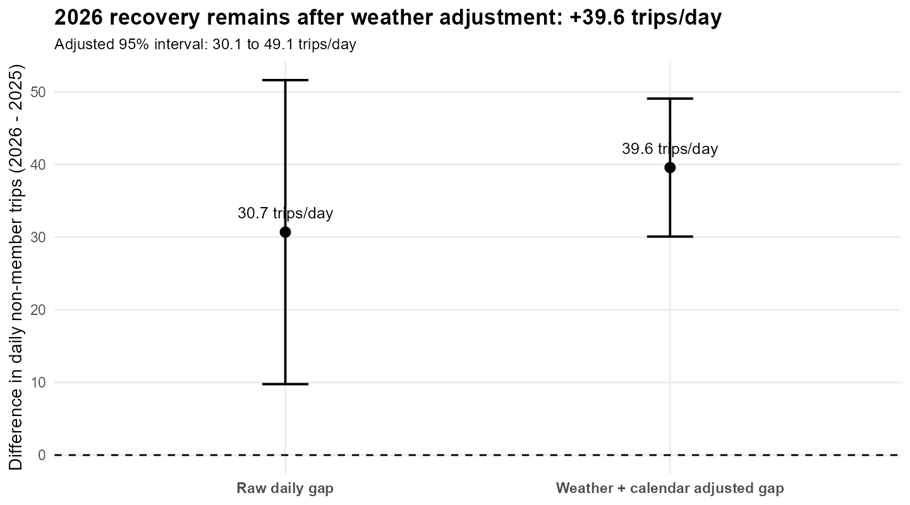

# Ride Knox: Two Years, One System

## 2026 verdict

After adjusting for weather and calendar structure, 2026 ran **39.6 more non-member trips per day** than 2025 over the shared January 1-October 11 window (95% interval: **30.1 to 49.1**).

The raw gap was positive, and the adjusted result is larger. Weather and calendar structure were masking part of the recovery rather than explaining it away. The comparison describes the broader 2026 operating environment; it does not isolate the Day Pass from other changes.

## Read the story

- **[2026 Annual Report](annual_report.html)** - full audit trail, two-year comparison, capacity scorecard, and General Manager memo.
- **[2025 Analysis Report](2025/report.md)** - the original baseline chapter.
- **[2026 Mid-year Operations Memo](2026/memo_2026.md)** - the earlier Day Pass and capacity decision.
- **[Project README](README.md)** - how a successor rebuilds the system with one command.

## Coverage note

The comparable window ends on October 11, 2026 because the October 2026 delivery is truncated. The system records that intake decision and the report uses the same cutoff throughout.
